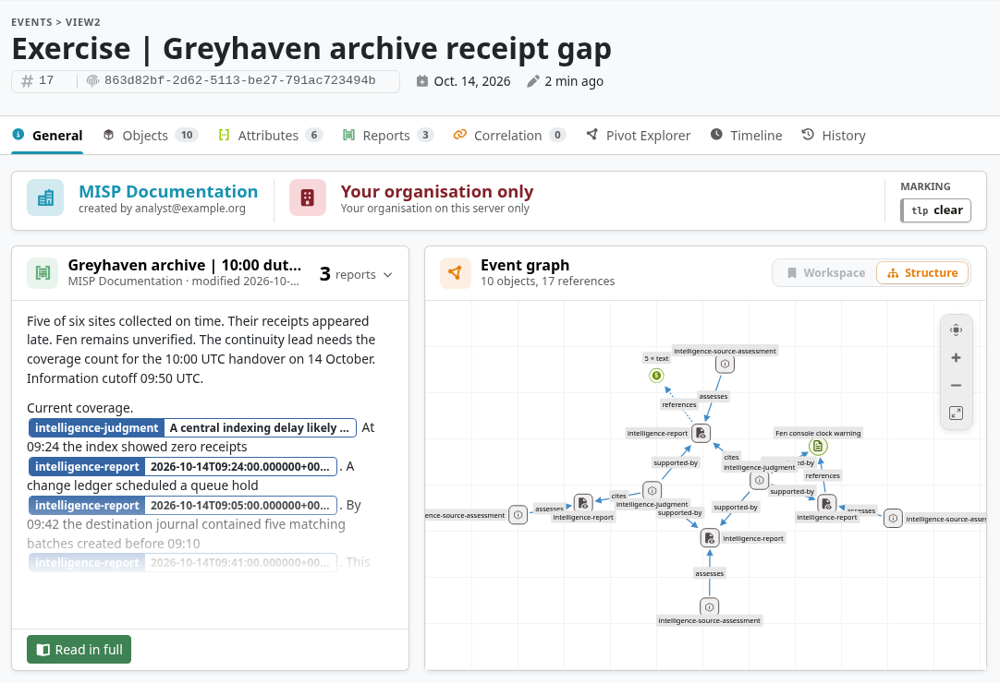
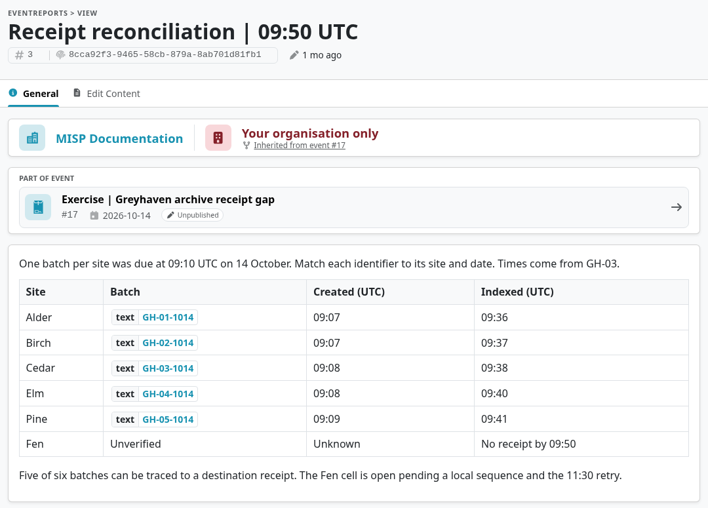
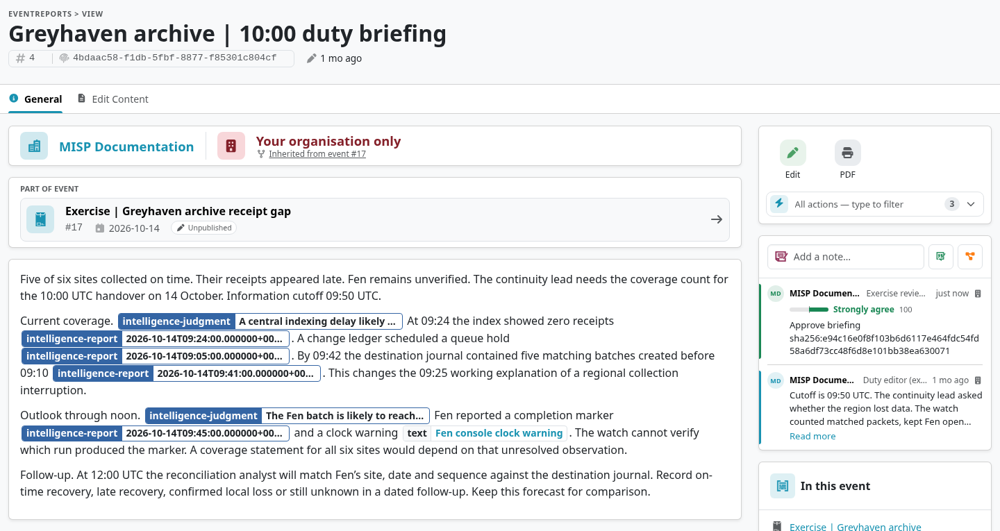
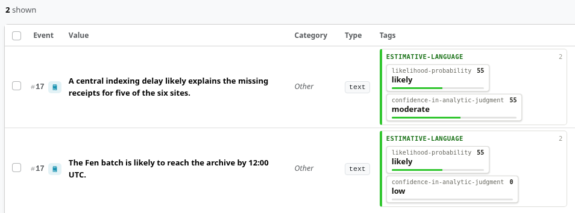
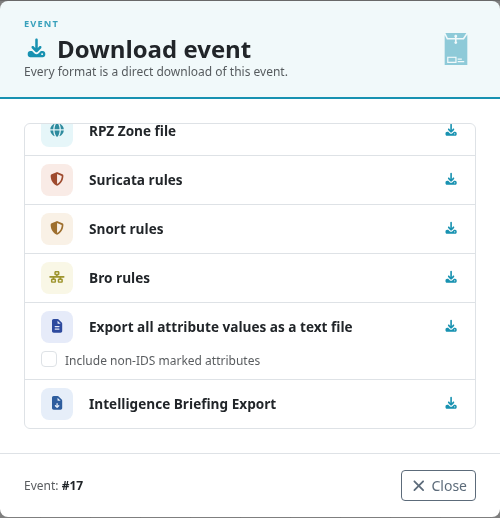
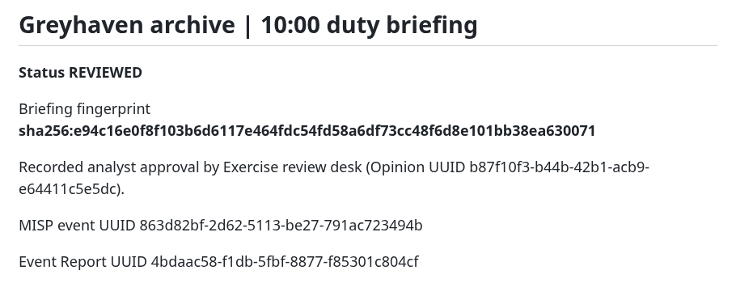

# Applying IC Analytic Standards in MISP

At 09:24 UTC the Greyhaven archive dashboard shows zero of six expected overnight batches. The continuity lead needs to know by 10:00 whether the region lost a morning of records. By handover, analysts can account for five batches. What can they say about the sixth?

This exercise follows the analyst who answers that question and the reviewer who challenges the answer. Import the event to inspect the evidence, follow each judgment back to its sources, and export a cited Markdown briefing. Greyhaven, its records and the people quoted are fictional. All exercise times are UTC on 14 October 2026.

[Download the MISP event (JSON)](greyhaven-event.json) · [Read the draft produced from that file](greyhaven-briefing.md)

## Open the case

1. Use a MISP `3.0_wip` instance with Event Reports and Analyst Data. For authoring, install the object definitions for `intelligence-report`, `intelligence-source-assessment` and `intelligence-judgment`. If the judgment template is missing, update the deployed object library to a revision containing the judgment template (`2156511` or a descendant). On the MISP object templates page, choose **Update Object** to load the definitions into the database. [Judgment template and revision](https://github.com/MISP/misp-objects/pull/599)
2. Use a misp-modules service containing **Cited Intelligence Briefing Export**. In the server's plugin settings, enable `Plugin.Export_services_enable`, point the export URL and port at the service, and enable `Plugin.Export_intelligence_briefing_export_enabled`. The service advertises `intelligence_briefing_export` at `GET /modules`. [Module and version details](https://github.com/MISP/misp-modules/pull/1160)
3. To import the example tags with a tagger account, first have an administrator enable the three [taxonomies and entries used in the event](#find-judgments-and-evidence-with-taxonomy-tags). From the event list, choose **Import Event → MISP Export File**, select `greyhaven-event.json`, leave **Publish imported events** clear, and submit **Import MISP file**. Open **Exercise | Greyhaven archive receipt gap**. The event uses **Your organisation only**, carries `tlp:clear`, and contains contextual attributes with IDS disabled. Local numeric IDs will differ from the screenshots.
4. Open the **Reports** tab. Read **09:25 watch assessment | Initial coverage** first, **Receipt reconciliation | 09:50 UTC** second, and **Greyhaven archive | 10:00 duty briefing** last. The briefing is the only report that cites judgment objects, so the exporter can select it automatically.

The event contains four source reports, four source assessments, two judgment objects, six standalone attributes and three Event Reports. On **General**, the graph connects the judgments to the underlying records. Open **Objects** to read a relationship in its original direction.



## Work from the records available at handover

Each site owes one batch by 09:10. The first analyst had the dashboard and a ticket repeating its count. The 09:25 watch assessment kept a regional interruption open and recorded low confidence. As new reporting arrives, keep the earlier report in the event so the next reader can reconstruct what was knowable then.

| INTREP | What the analyst received | How much weight it carries |
| --- | --- | --- |
| GH-01 · Operations desk · 09:25 | The receipt index showed 0/6 at 09:24. The help desk opened a ticket from that display. | Direct evidence of what the dashboard showed. Two records share one observation. Neither establishes that source collection stopped. |
| GH-02 · Change control · 09:32 | A ledger prepared before the gap scheduled an indexing hold from 09:05 to 09:35 and a retry at 11:30. | The schedule supplies a plausible mechanism. The runtime log would establish whether the hold actually ran. |
| GH-03 · Archive reconciliation · 09:42 | The destination journal matched five dated batch identifiers to origin records created at 09:07–09:09. Their receipts appeared at 09:36–09:41. | The journal supplies direct evidence for five arrivals. The creation times come from packet metadata. Fen has no matching receipt at cutoff. |
| GH-04 · Fen duty operator · 09:47 | The operator recalled a completion marker and read out a clock warning. The marker lacked a date or sequence number. | One witness supports two observations. Yesterday's marker would look much the same. A dated local manifest would distinguish the two runs. |

Open the `intelligence-source-assessment` for GH-04. The assessor gave the source **C – Fairly reliable**, the information **3 – Possibly true**, and the evaluation **low** confidence. The `evaluation` field explains the missing sequence. Compare GH-03, where the destination journal and five identifiers justify high confidence in the source evaluation. Each assessment's `related-report` matches a unique INTREP `report-id`. A report UUID also works when report IDs are reused.

The reconciliation report keeps the denominator visible. Select a blue batch identifier to inspect its underlying text attribute, observation time and provenance. Fen stays in the sixth row even though it has no receipt. Treating a blank cell as a zero, or counting only sites that replied, would give the lead a different answer.



## Make two claims the reader can test

**J1 · What happened at five sites?** A central indexing delay **likely** explains the five late receipts. Confidence is **moderate**. Five distinct identifiers establish receipt, and their pre-deadline creation times support continued collection. Their arrival just after the scheduled hold favors the indexing explanation. A transport backlog fits the same sequence. Delivery timestamps after 09:35 together with an idle indexer would shift the assessment toward transport delay. This revises the 09:25 hypothesis for five sites and leaves Fen open.

**J2 · What should the lead expect by noon?** The Fen batch is **likely** to reach the archive by 12:00. Confidence is **low**. That forecast depends on two assumptions. The completion marker belongs to today's run, and the scheduled retry can replay the batch. A missing local batch would defeat the second assumption. The archive reviewer favors a **roughly even chance** and records why in an Analyst Opinion on J2. At handover the lead can report five verified sites and one outstanding site. A statement of full regional coverage still depends on Fen.

In this exercise *likely* uses the ICD 203 likelihood band of 55–80%, and *roughly even chance* uses 45–55%. Confidence describes the strength of the basis for a judgment. The reviewer's **25/100** is an agreement score on J2. Keep the source ratings, forecast likelihood, judgment confidence and analyst agreement in their respective fields. [ICD 203, section D.6.e(2)](https://www.dni.gov/files/documents/ICD/ICD-203.pdf)

### Encode the argument

1. On the event, add an `intelligence-report` object for each distinct source report. Record the reporting unit, activity time, time received or reported, report ID and narrative. Keep the provenance of derivative reporting explicit. Add a separate `intelligence-source-assessment` with the collection method, source reliability, information credibility, evaluation and any limits on coverage.
2. Add one `intelligence-judgment` per claim. Fill `title`, `judgment`, `confidence`, `confidence-rationale` and `alternative`. Write down the evidence that would distinguish the alternative. The two judgment objects in the fixture can be inspected under **Objects**.
3. In **Edit relationships**, link a judgment to its evidence. J1 is `supported-by` GH-02 and GH-03 and `cites` GH-01. J2 is `supported-by` GH-02 and GH-04, `cites` GH-03 and is `contradicted-by` the clock-warning attribute. The warning weakens the inference from the marker. It does not establish that a batch was lost.
4. Use an Analyst Relationship when the target is another Event Report. J1 `references` the 09:25 assessment this way. The module also recognizes `based-on` from a judgment to evidence and `supports` or `contradicts` in the reverse direction. A generic `related-to` link will not make an evidence citation.
5. Write the customer-facing narrative in an **Event Report**. Insert each judgment using a native object reference, for example `@[object](78525216-886e-5324-8a4a-db45516a56fc)` for J1. Use native attribute references for individual observations. State the information cutoff, decision deadline, implications and next check in the narrative. Attach a Note for the editor's cutoff and an Opinion to the disputed judgment so dissent travels with the claim.



## Find judgments and evidence with taxonomy tags

A reviewer at handover wants to find claims the watch calls *likely* despite weak evidence. J1 and J2 both use *likely*, but only J2 has **low** confidence. The example puts both machine tags on each object's `judgment` attribute. This lets a reviewer search for the combination and open the precise claim that needs attention.

**Source reliability and information credibility (standard 1).** Each INTREP carries its Admiralty grades on its `narrative` attribute. GH-01 through GH-03 have `admiralty-scale:source-reliability="b"` and `admiralty-scale:information-credibility="2"`. On GH-04, `admiralty-scale:source-reliability="c"` rates the operator as fairly reliable. `admiralty-scale:information-credibility="3"` rates this particular account as possibly true. Open the source assessment for the collection method and the missing sequence number. [Admiralty Scale](https://github.com/MISP/misp-taxonomies/blob/27a72012c540af6db256462ba5f95767d5ed4c39/admiralty-scale/machinetag.json)

**Likelihood and judgment confidence (standard 2).** Both claims carry `estimative-language:likelihood-probability="likely"`. J1 also carries `estimative-language:confidence-in-analytic-judgment="moderate"` and J2 carries `estimative-language:confidence-in-analytic-judgment="low"`. The reviewer's *roughly even chance* estimate stays in the dissenting Opinion so readers can tell whose estimate it is. In the screenshot, the small 0 beside *low* is the taxonomy's numeric value for that confidence category. Fen's assessed likelihood is still 55–80%. [Estimative language and its ICD 203 bands](https://github.com/MISP/misp-taxonomies/blob/27a72012c540af6db256462ba5f95767d5ed4c39/estimative-language/machinetag.json)



**How the watch challenged its assumptions (objectivity and standard 4).** The 10:00 Event Report carries `event-assessment:alternative-points-of-view-process="intra-office-peer-review"`. Follow J2 to the archive reviewer's Opinion for the competing interpretation of the marker and the evidence that would change the reviewer's mind. [Event assessment](https://github.com/MISP/misp-taxonomies/blob/27a72012c540af6db256462ba5f95767d5ed4c39/event-assessment/machinetag.json)

To apply the tags to an existing copy, enable the namespaces and their entries on MISP's **Taxonomies** page. In the event's **Objects** tab, expand the INTREP or judgment and use the **+** in the **Tags** column on the named attribute. To attach the method to the briefing through the API, use `POST /eventReports/addTag/<report-id>/<tag-id>` with the IDs from your instance.

When a rating changes, update its tag, structured value and rationale together. The analytic tags make the records searchable in MISP. The briefing exporter reads the judgment and source-assessment fields for its Markdown and carries handling markings such as `tlp:clear` into the file.

To reproduce the handover search, send this JSON body to MISP's `POST /attributes/restSearch`. The supplied event returns one attribute, **The Fen batch is likely to reach the archive by 12:00 UTC.** Following its parent judgment reveals the retry assumption and the contrary clock warning.

```json
{
  "returnFormat": "json",
  "eventid": "863d82bf-2d62-5113-be27-791ac723494b",
  "tags": {
    "AND": [
      "estimative-language:likelihood-probability=\"likely\"",
      "estimative-language:confidence-in-analytic-judgment=\"low\""
    ]
  }
}
```

### Tags for follow-up work

- **Request independent corroboration (standards 1 and 4).** While Fen's sequence is unknown, the watch can tag the clock-warning attribute `collaborative-intelligence:request="complementary-validation"` and specify the dated local manifest it needs in a Note. [Collaborative intelligence](https://github.com/MISP/misp-taxonomies/blob/27a72012c540af6db256462ba5f95767d5ed4c39/collaborative-intelligence/machinetag.json)
- **Queue the handover review.** A watch desk can place `workflow:todo="review-before-publication"` on the draft Event Report and remove it when the review is complete. The fingerprint-matched Opinion records approval of the particular export. [Workflow](https://github.com/MISP/misp-taxonomies/blob/27a72012c540af6db256462ba5f95767d5ed4c39/workflow/machinetag.json)
- **Evaluate the delivered product (timeliness and standards 5–6).** If the continuity lead confirms that the five-site count answered the decision question, a reviewer could tag the 10:00 report `cti-evaluation:relevance="high"` and record the feedback in a Note. If the lead could restate both the five-site finding and the uncertainty about Fen, record that observation when assigning a clarity rating such as `cti-evaluation:clarity="high"`. Rate timeliness against when the lead actually received the briefing. [CTI evaluation](https://github.com/MISP/misp-taxonomies/blob/27a72012c540af6db256462ba5f95767d5ed4c39/cti-evaluation/machinetag.json)

A reviewer can test the remaining questions directly in the event. J2 names the assumption about the completion marker (standard 3). The 09:25 report preserves the earlier judgment (7). The noon follow-up scores the forecast against its deadline (8). The reconciliation table shows the missing site alongside the five confirmed arrivals (9).

## Export and review the briefing

On the event, search **All actions** for **Download as**, open it, then choose **Intelligence Briefing Export**. The download menu uses this shorter label for the **Cited Intelligence Briefing Export** module. The event can stay unpublished throughout the exercise.



Open the Markdown file. The first export reads **DRAFT**. Expect two judgments, six source entries, four INTREP source assessments, the editor's Note and the dissenting Opinion. The source appendix numbers the four INTREPs **S1–S4**, the clock-warning attribute **S5**, and the earlier Event Report **S6**. Follow J2's contrary-evidence link to S5 and use its UUID to return to the observation in MISP. Receipt identifiers remain accessible in the event through GH-03. The appendix lists the evidence actually cited by the product.

### Review against the IC standards

ICD 203 asks for objective analysis, independence from political considerations, timely delivery, use of all available intelligence, and application of nine tradecraft standards. For Greyhaven, the lead sets the question and the deadline. The watch checks all four available source streams, records the missing logs, and preserves a reviewer's disagreement even though a single regional answer would be easier to brief. A reviewer can use the following questions before the 10:00 handover. [IC Analytic Standards and objectivity](https://www.intelligence.gov/mission/our-values/objectivity) · [ICD 203, section D.6](https://www.dni.gov/files/documents/ICD/ICD-203.pdf)

| Tradecraft standard | What the reviewer checks in this event |
| --- | --- |
| 1. Source quality and method | Open S1 and S3. Can you reconstruct how each count was obtained? Is the help-desk ticket counted once with the dashboard? |
| 2. Uncertainty | Read J2's rationale. What supports the forecast, why is confidence low, and what could change it? |
| 3. Information, assumptions and judgments | Trace the five receipts to GH-03. Identify the unverified assumption about the date of Fen's completion marker. |
| 4. Alternatives | Test transport delay against an indexing hold for J1 and local collection failure against a pending retry for J2. Identify one observation that would distinguish each pair. |
| 5. Customer relevance and implications | Can the lead say how many sites are verified at 10:00 and what remains at risk until noon? |
| 6. Logical argument | Follow the first sentence to J1, its supporting links and the source evaluations. Can the five-site conclusion be reached without treating the schedule as execution evidence? |
| 7. Change or continuity | Compare the 09:25 and 10:00 reports. Does the briefing say which evidence narrowed the regional hypothesis and which site remains unresolved? |
| 8. Accuracy | Record the noon outcome against the forecast's original deadline. Check the site, date and sequence. Preserve an inconclusive outcome when the requisite records are missing. |
| 9. Visual communication | Inspect the six-row reconciliation table. Can the reader see the five late arrivals, their creation times and the unresolved site without relying on color? |

### Record approval and exercise the release check

1. Review the visible sources, wording, dissent and handling markings for the intended audience. The module checks citation resolution and required judgment content. The reviewer evaluates the reasoning, source independence and accuracy.
2. Copy the current **briefing fingerprint** from the downloaded file. On **Greyhaven archive | 10:00 duty briefing**, choose **Add an opinion** in the Analyst Data panel. Supply an author, set the agreement score to express the reviewer's view, and put exactly `Approve briefing sha256:<digest>` in the comment, replacing `<digest>` with the 64 hex characters. The approval belongs to this Event Report. The separate agreement score on J2 continues to express dissent. The Event Report screenshot above shows both the editor's Note and the training reviewer's later approval.
3. Download again. With all release checks satisfied, the header reads **REVIEWED** and identifies the approving Opinion. The screenshot shows the rendered Markdown from a reviewed training run. Use the digest from your own export. MISP can add evidence timestamps and normalize values on import.
4. In a training copy, change the value of the cited Fen clock-warning attribute and export again. Expect a new fingerprint and **DRAFT**. A strict module request returns warnings and no file. Review the changed record and repeat approval only after reassessing the claim. If a citation cannot be resolved for a recipient, check that recipient's access and revise the product for that audience.



### Reproduce the export with the module API

The following Bash example uses the downloaded event and a local misp-modules service. It prints the validation summary and decodes the module's Markdown response. Set `MODULES_URL` to the URL of your service, including its port.

```bash
set -o pipefail
MODULES_URL="${MODULES_URL:-http://127.0.0.1:6666}"
jq '{module: "intelligence_briefing_export", data: .}' greyhaven-event.json |
  curl --fail --silent --show-error -H 'Content-Type: application/json' \
    --data-binary @- "${MODULES_URL}/query" > briefing-response.json
jq '{summary, warnings, error}' briefing-response.json
jq -er '.data // error(.error // "No briefing returned")' briefing-response.json |
  base64 --decode > greyhaven-draft.md
```

The supplied file yields `status: draft`, `judgments: 2`, `sources: 6`, `issues: 0` and a warning about missing approval. For strict release, submit the current authorized event export **including Event Reports and Analyst Data** and set `config.require_reviewed` to `true` on the module request. When several reports cite judgments, also set `config.report_uuid` to the intended Event Report UUID. For this briefing it is `4bdaac58-f1db-5fbf-8877-f85301c804cf`. For a file named `current-event.json` containing that export, run the check below. A successful response has a matching Opinion UUID and a file in `data`. A refused release has an `error` and warnings.

```bash
jq '{module: "intelligence_briefing_export", data: .,
     config: {report_uuid: "4bdaac58-f1db-5fbf-8877-f85301c804cf", require_reviewed: true}}' current-event.json |
  curl --fail --silent --show-error -H 'Content-Type: application/json' \
    --data-binary @- "${MODULES_URL}/query" > release-response.json
jq '{summary, warnings, error}' release-response.json
jq -e '.summary.status == "reviewed" and (.data | type == "string")' release-response.json
```

MISP controls who may see the underlying event and evidence. When distributing the Markdown separately, check the recipient list and retain the applicable handling markings. The file carries the source UUIDs so authorized readers can return to MISP. [Cited intelligence briefing export reference](https://github.com/MISP/misp-modules/blob/4d78a17046c7dc4a43ca4d6f958ecb3ba586c9f4/documentation/export_mod/intelligence_briefing_export.md)

## Close the forecast at noon

For a follow-up exercise, give the reviewer a new simulated observation **after** recording the forecast. At 12:07 the destination receives Fen's correctly dated batch. Its journal confirms there was no earlier arrival for that sequence.

Add the receipt as a new attribute and write a dated follow-up Event Report. Record **five of six verified at 09:50**, **no matching Fen receipt by 12:00**, and **six of six verified at 12:07**. Score J2's deadline forecast as missed. The late receipt resolves the question of eventual recovery, while the cause of the delay still requires queue or transport evidence. Retain the original opinion and forecast so another analyst can compare the two products using the evidence available at each cutoff.
